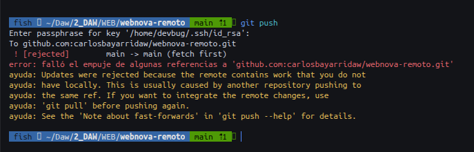
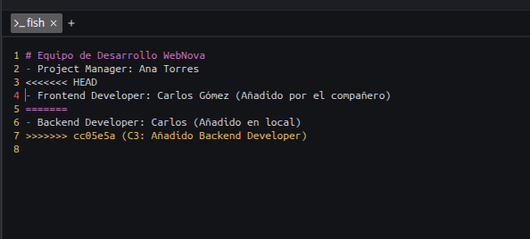
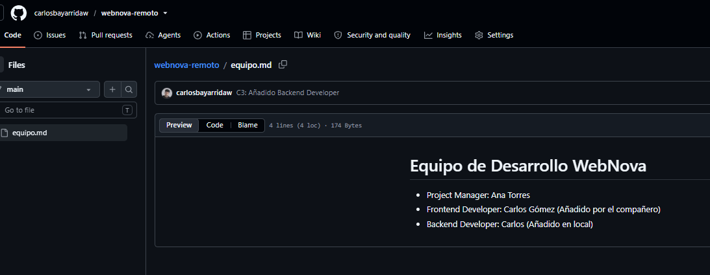

# Práctica 5 — Entregable

**Carlos · Despliegue de Aplicaciones Web**

## 1. Error al hacer `git push`

## 2. Conflicto antes de resolverlo

## 3. Resultado final en GitHub

## 4. Pregunta de reflexión
**Explica con tus palabras por qué Git bloqueó tu subida en la Fase 3 y qué ventaja tiene usar git pull --rebase en lugar de un simple git pull en estos casos.**

Git rechazó el push porque en github ya había cambios que yo todavía no tenía en local, me pasó algo parecido en la práctica anterior con los HTML, pero allí el conflicto fue entre dos ramas y esta vez entre mi repositorio local y github.

Para solucionarlo usé git pull --rebase, que primero trae los cambios de github y después aplica los míos, Como había modificado el mismo archivo tanto desde github como en local, tuve que juntar los cambios para poder subirlo todo sin crear un commit extra con merge, dejando el historial más ordenado y en línea recta.
